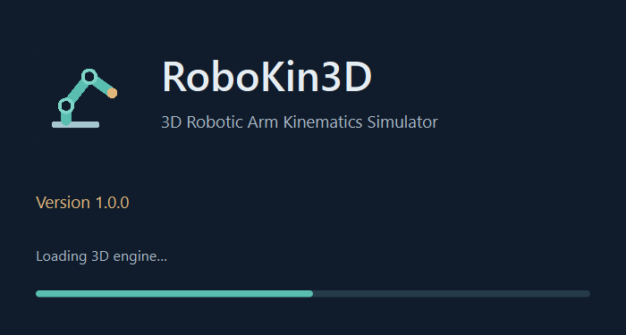
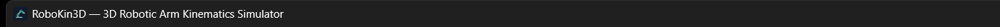

# RoboKin3D branding, splash and local Windows build verification

Verified on the existing Windows x64 host with project-local Python 3.12.10. The original simplified robotic arm uses navy `#101c2b`, teal `#59bdb0`, cyan/mint `#7ed5c7`, and gold `#e2b77c`. No branding assets were downloaded. FK, IK and motion algorithms were not changed.

## Files

| Files | Purpose |
| --- | --- |
| `resources/robokin3d.svg`, `.png`, `.ico` under `src/robotic_arm_simulator/` | Original vector, 512px PNG and ICO frames at 16/24/32/48/64/128/256px |
| `src/robotic_arm_simulator/branding.py` | Package-relative icon loading, product name, process-scoped Windows AppUserModelID |
| `src/robotic_arm_simulator/startup.py` | Native high-DPI splash, real startup stages, lifecycle and rotating diagnostics |
| `src/robotic_arm_simulator/__main__.py`, `ui/main_window.py` | Startup integration and application/window icon assignment |
| `pyproject.toml`, `src/robotic_arm_simulator/__init__.py` | Version 1.0.0, resource inclusion, RoboKin3D launch alias, optional build dependency |
| `RoboKin3D.spec`, `packaging/entrypoint.py`, `packaging/version_info.txt`, `packaging/README.txt` | Windowed portable build, embedded icon/version and end-user instructions |
| `scripts/generate_branding.py`, `scripts/build_windows.py` | Asset generation and repeatable local ZIP build |
| `scripts/verify_branding.py`, `scripts/verify_frozen_branding.py`, `scripts/verify_windows_controls.ps1` | External native visual, PE and packaged UI verification |
| `tests/test_branding_startup.py`, `tests/test_foundation.py` | Asset, DPI, startup/failure/lifecycle coverage and readiness-based production launch regression |
| `requirements-build.txt`, `BUILDING_WINDOWS.md`, `README.md` | Pinned build tools, build/launch instructions and updated project status |
| `DESIGN.md`, `.impeccable/design.json`, `.impeccable/review/branding/` | Scoped branding tokens and visual/native evidence |

## Splash and startup

The 560 × 300 logical-pixel navy Qt splash shows the arm mark, RoboKin3D, the full simulator subtitle, Version 1.0.0, a thin indeterminate teal indicator, and real status messages: loading the 3D engine, creating the robotics workspace, and preparing the 3D view and controls. It appears before importing the VTK workspace. Initialization stages are scheduled through Qt and painting is flushed between them. There are no fake percentages, network calls or artificial delays.

The main window is shown and the splash dismissed automatically. Clicking the splash does not hide it prematurely. On import, window-construction or finishing failure, the splash and partial main window close, a recovery dialog appears without raw exception details, and the application exits with code 1. The log preserves the exception. Native imports and Qt/VTK window creation remain on the GUI thread; the busy indicator can pause during those bounded operations. This implementation does not promise continuous animation during heavy imports.

## Checks and results

- Full regression suite: **169 passed in 83.48 seconds**, no warnings. Includes real 3D rotation/zoom/pan, joint transforms, FK, matrix, IK, motion transport and shutdown.
- Focused branding/startup + existing GUI checks: **47 passed in 80.57 seconds**.
- Resource loading and logical layout passed with Qt scale multipliers 1, 1.5 and 2, including launch from another directory. Captured on the host's 125% monitor, those multipliers produce actual DPR **1.25, 1.875 and 2.5**. Screenshot directory names indicate multipliers, not the monitor's final percentage.
- Injected import, construction and finish failures verified splash dismissal, sanitized dialog text, diagnostic logging and exit status. Successful lifecycle and the real production entrypoint close cleanly.
- `pip check`, Python compilation, PowerShell parser validation and `git diff --check` passed.
- Independent native visual review: **ship**, limited to the original icon and splash; incumbent workspace design preserved.
- Local PyInstaller 6.22.3 versioned build: **87.52 seconds**, **395,761,329 bytes** unpacked, **137,629,111 bytes** ZIP, **1,456 files**. This is an incremental local build measurement, not a guaranteed clean-build time.
- ZIP CRC validation, required `qwindows.dll`, branding/stylesheet resources and development-file exclusions passed. No application tests, `.venv` folder, standalone Python sources or loose `.pyc` files are distributed; Python modules are inside the runtime archives.
- Both the local build and an independently extracted ZIP launched from an unrelated temporary working directory with `VIRTUAL_ENV`/`PYTHONPATH`/`PYTHONHOME` removed and a system-only PATH. Windows module inspection confirmed bundled `python312.dll` and no development `.venv`/source modules loaded.
- Actual extracted executable: splash observed, main window opened, seven embedded PE icon frames verified, windowed GUI subsystem verified, native small/large icons present, clean close with exit code **0**. Window visibility measured **12.107 seconds** on the extracted run; startup log recorded main-ready in **9.373 seconds** after splash-controller creation. A preceding warm run measured **5.176 seconds** to the native window. These are host observations, not benchmarks or artificial delays.
- External Windows UI Automation drove packaged sliders/FK, coordinates and matrix tab, IK calculate/apply, clipboard export, animate/pause/resume/stop, reset, preset load and Reset view successfully. Source tests additionally exercise camera drag/zoom/pan and full animation completion; these camera gestures were not separately automated against the EXE.

## Icon locations

| Location | Verification |
| --- | --- |
| Application icon | Qt application icon loads; all seven ICO frames are present |
| Main-window title bar | Visually confirmed in live Windows capture; native small and large icon handles are nonzero |
| Executable | All seven RT_ICON frames and RT_GROUP_ICON embedded in RoboKin3D.exe; original arm visible in packaged title bar |
| Windows taskbar | Process AppUserModelID setter succeeded before QApplication; native icons assigned. Taskbar artwork was not independently visually confirmed |
| Alt + Tab | Native large icon assigned. Switcher artwork was not independently visually confirmed |

The process identity follows the [Windows AppUserModelID API](https://learn.microsoft.com/en-us/windows/win32/api/shobjidl_core/nf-shobjidl_core-setcurrentprocessexplicitappusermodelid). Windows may retain old artwork for existing pinned shortcuts or Explorer cache entries. Unpin an old shortcut, launch the new executable, and pin the running application again if needed. No automatic cache clearing, registry modification or pinned-shortcut change was made. No clean Windows machine/VM or secondary physical monitor was available; same-host isolation does not replace that verification.

## Screenshots

[Higher-DPI splash, 1.875 DPR](.impeccable/review/branding/scale-150/splash.png) · [Higher-DPI splash, 2.5 DPR](.impeccable/review/branding/scale-200/splash.png) · [Workspace](.impeccable/review/branding/scale-100/workspace.png) · [Frozen verification data](.impeccable/review/branding/frozen/verification.json).

## Dependencies and launch

No new runtime dependency was needed. Asset generation uses existing QtSvg and Pillow. Only local build tooling was installed: PyInstaller 6.22.3, pyinstaller-hooks-contrib 2026.9, altgraph 0.17.5, pefile 2024.8.26 and pywin32-ctypes 0.2.3. Versions are pinned in `requirements-build.txt`.

Source launch: `.\.venv\Scripts\python.exe -m robotic_arm_simulator`.

Portable launch: extract `dist/RoboKin3D-v1.0.0-Windows-x64.zip`, then run `RoboKin3D/RoboKin3D.exe` beside its `_internal` directory. Build outputs remain ignored by Git. No Git push or GitHub release was performed. Before public distribution, test on a clean Windows installation and visually check Explorer/taskbar/Alt + Tab with fresh shortcuts.
