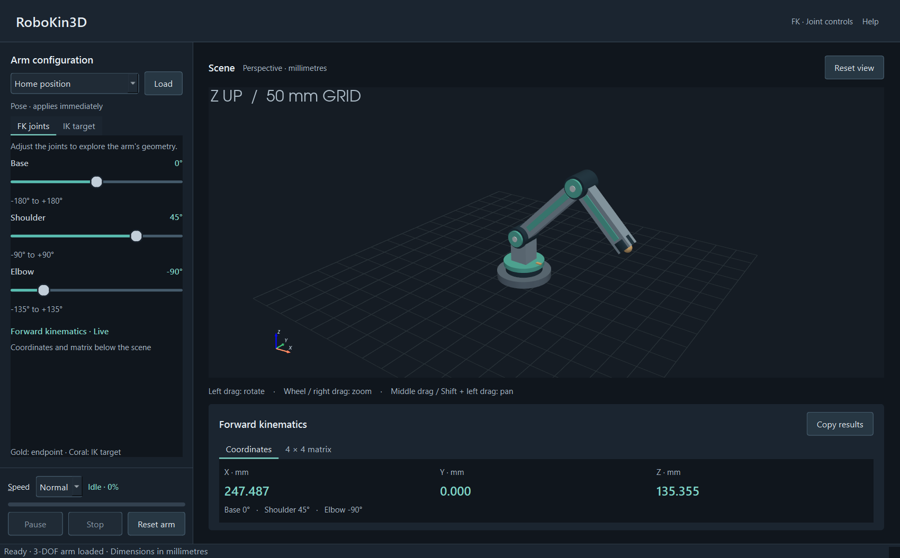
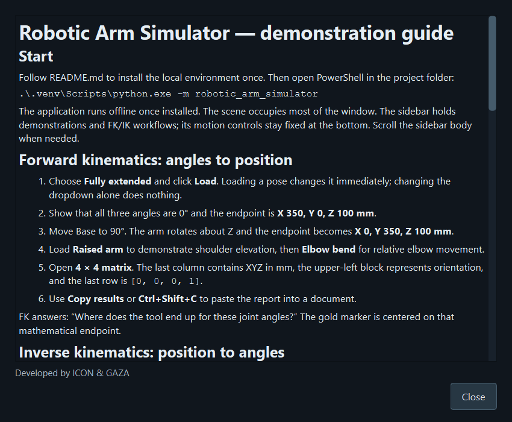

# RoboKin3D v1.0.1 verification ? 18 November 2026

The developer acknowledgement is at the bottom of USER_GUIDE.md and at the bottom of its native in-app guide dialog. The user approved a quiet Help text button at the top-right of the existing header. There is no About window/menu bar, no developer name in the main workspace or viewport, and no splash branding change. Only the splash version updates to 1.0.1 through the existing version constant.

- Full suite: **170 passed in 155.86 seconds**, no warnings.
- Existing FK, IK, motion, camera and real Qt/VTK rendering regressions passed. No simulation algorithm or rendering files changed.
- Original User Guide content is preserved; the sole document addition is the small muted footer.
- Python project/runtime version, Windows file/product metadata, portable README and ZIP filename all use 1.0.1. PE file version verified as 1.0.1.0.
- Existing project-local Python 3.12.10 / PyInstaller build completed in 115.67 seconds. No new Python dependencies.
- ZIP: **137,627,588 bytes**, 1,456 files; unpacked size 395,762,555 bytes. CRC and bundled guide-footer checks passed.
- SHA-256: `13d3a17b9e5d2bffe3e61e2cb8d8424252e605ea633488df01b75fc6091ac3f2`.
- Freshly extracted copy launched from an unrelated temporary directory with Python environment variables removed and system-only PATH. Native window visible after 12.763 seconds; splash observed and dismissed.
- Windows UI Automation passed header Help, guide credit, dialog close, FK/sliders, matrix, IK, clipboard, animate/pause/resume/stop, reset and preset load. Bundled Python runtime verified; application exited with code 0.
- Verification harness fixes: corrected its window-title encoding, supported owned Qt dialogs, and handled an initially empty clipboard. The application binary was unchanged during those harness fixes; final checks passed.
- `pip check` and `git diff --check` passed. Build output and development environment remain excluded from Git.

Limitations: same-host extraction/isolation is not a clean Windows installation test. Executable remains unsigned. v1.0.0 release/tag/assets are preserved; v1.0.1 is a separate maintenance release.
