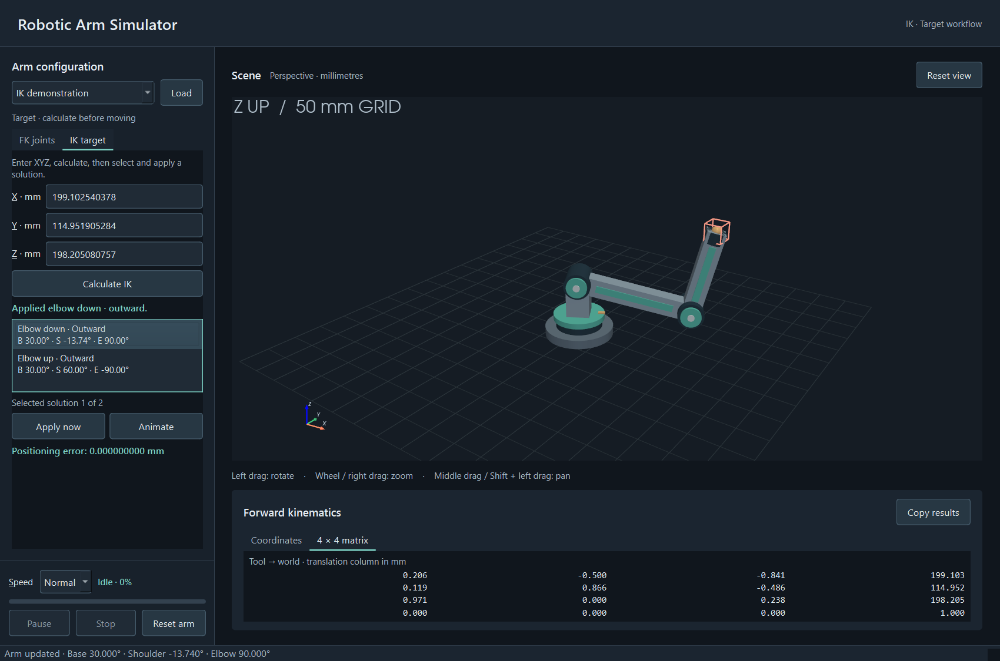
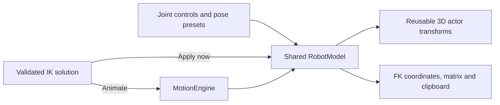

# RoboKin3D — Robotic Arm Kinematics Simulator

A Python desktop application for visualizing and understanding the forward and inverse kinematics of a three-degree-of-freedom robotic arm.

Developed for the university course project **Development of a Software Application for Modeling Forward and Inverse Kinematics of a Robotic Arm Using Python (3D Modeling)**, the simulator connects joint angles, robot geometry, transformation matrices, and endpoint coordinates in one interactive workspace.

**Forward kinematics (FK)** answers where the tool ends up for a set of joint angles. **Inverse kinematics (IK)** finds valid joint angles for a requested position. Both use the same model that positions the rendered arm, so the visualization reflects the calculations.



### What the application does

- Displays a mechanically modeled 3-DOF arm with orbit, zoom, pan, axes, and a reference grid.
- Provides base, shoulder, and elbow sliders with enforced limits and live XYZ/matrix results.
- Solves analytical IK with multiple elbow and signed-radial branches, reachability checks, and singularity handling.
- Supports immediate application or smooth, cancellable motion with speed, pause/resume, stop, and reset controls.
- Includes five demonstration presets, keyboard interaction, input recovery, and report-ready clipboard export.
- Runs locally without a server, database, or internet connection after dependencies are installed.

**Project status:** Phases 1–6 are implemented and verified. Phase 7 now has a locally verified Windows portable build with original application branding and a native startup splash. Distribution on a clean Windows machine remains unverified. This is an educational kinematics simulator, not a physical robot controller.

Technologies: **Python 3.12**, **PySide6 Essentials** for desktop widgets, **PyVista/PyVistaQt and VTK** for 3D rendering, **NumPy** for mathematics, and **pytest** for verification. Windows builds use **PyInstaller**. No server, API, database, or SciPy is required.

For Windows, download **RoboKin3D-v1.0.0-Windows-x64.zip** from the [v1.0.0 release](https://github.com/ICON-byte/robotic-arm-simulator/releases/tag/v1.0.0), extract the entire archive, open the `RoboKin3D` folder, and run `RoboKin3D.exe`. Keep its `_internal` folder alongside the executable. No Python installation is needed. See [BUILDING_WINDOWS.md](BUILDING_WINDOWS.md) and [BRANDING_STARTUP_VERIFICATION.md](BRANDING_STARTUP_VERIFICATION.md) for build instructions, screenshots, diagnostics, and verification limits.

For a short classroom walkthrough, see [USER_GUIDE.md](USER_GUIDE.md).

### Read this README

[Installation](#installation) · [Geometry and joints](#joint-controls-and-geometry) · [Forward kinematics](#forward-kinematics) · [Inverse kinematics](#inverse-kinematics) · [Motion](#motion-controls) · [Presets](#demonstration-presets) · [Architecture](#architecture-and-project-structure) · [Verification](#verification) · [Limitations](#limitations-and-next-phase)

## Installation

The verified environment is **Windows with 64-bit Python 3.12.10** and a working graphics driver for Qt/VTK rendering. Python 3.12 is required by this project's configuration. Other operating systems and graphics configurations have not been verified.

For a fresh checkout, run in PowerShell:

```powershell
git clone https://github.com/ICON-byte/robotic-arm-simulator.git
cd robotic-arm-simulator
py -3.12 -m venv .venv
.\.venv\Scripts\python.exe -m pip install -r requirements-lock.txt
.\.venv\Scripts\python.exe -m pip install --no-deps --no-build-isolation -e .
.\.venv\Scripts\python.exe -m robotic_arm_simulator
```

Git is needed only for cloning. If you download the repository ZIP instead, extract it and open PowerShell in the project folder before creating the virtual environment. For an existing checkout with its environment installed, use the launch command below.

## Launch

From this project directory in PowerShell:

```powershell
.\.venv\Scripts\python.exe -m robotic_arm_simulator
```

No environment activation or PowerShell execution-policy change is necessary. The application runs locally without a server, API, database, or internet connection once dependencies are installed.

## Recreate the environment

Python 3.12 (64-bit) is required. The initial environment uses the existing Python 3.12.10 installation.

The GUI uses the official `PySide6-Essentials` distribution, which provides the `PySide6` QtWidgets/QtGui/QtCore modules used here. The full PySide6 meta-package would also install unused PDF and embedded-browser components. VTK and QtPy are installed through the visualization dependencies.

VTK is fixed at 9.5.2 rather than automatically selecting the newest renderer. NumPy is constrained below 2.5 to avoid upstream VTK array-shape deprecation warnings. The complete environment is recorded in the lock file after verification.

```powershell
py -3.12 -m venv .venv
.\.venv\Scripts\python.exe -m pip install -r requirements-lock.txt
.\.venv\Scripts\python.exe -m pip install --no-deps --no-build-isolation -e .
```

`requirements-lock.txt` records the verified Windows environment. For dependency updates, use `pip install -e ".[dev]"`, verify the application, then regenerate the lock with `pip freeze --exclude-editable`.

If a restricted shell blocks temporary-file access during setup, use a normal PowerShell session with a writable temporary directory. Do not replace the global interpreter. Installation downloads require internet; the installed application runs offline.

## Camera interaction

- Left drag: orbit the scene.
- Mouse wheel or right drag: zoom.
- Middle drag or Shift + left drag: pan.
- **Reset view** or **Ctrl+Home**: restore the perspective camera.

The ground grid has 50 mm spacing, labeled in the scene. The orientation marker identifies X/Y/Z; Z is upward. Switch between **FK joints** and **IK target** without resetting the robot. The header identifies the current workflow even when the sidebar is scrolled. FK coordinates, matrix, and Copy results remain available in either mode.

## Joint controls and geometry

| Parameter | Value |
|---|---|
| Shoulder height | 100 mm |
| Upper-arm length | 200 mm |
| Forearm length | 150 mm |
| Base limits | −180° to +180° |
| Shoulder limits | −90° to +90° |
| Elbow limits | −135° to +135° |
| Initial configuration | 0°, 45°, −90° |

Sliders use whole-degree positions and show the current angle and permitted range. Arrow keys adjust a focused slider; Home/End select its limits. After IK, labels retain fractional angles (up to three decimals), while slider thumbs indicate the nearest whole-degree position. Moving one slider changes only that joint; the other joints retain their exact IK angles. **Reset arm** restores the initial configuration, clears IK solutions/marker, and keeps the camera and target input text. **Reset view** restores the camera without changing the arm or target.

Keyboard: Tab/Shift+Tab traverse controls; Alt+X/Y/Z focus target fields; Enter calculates IK without moving and focuses the solution list on success; arrows select a solution. **Ctrl+R** resets the arm, **Ctrl+Home** resets the camera, and **Ctrl+Shift+C** copies FK results. Invalid-input text names the affected coordinates, focuses the first bad field, and supplements color with instructions. A counter identifies the selected solution.

The right-handed frame has X forward, Y left, and Z up. Positive base rotation turns X toward Y. At shoulder 0°, the upper arm points horizontally outward; positive elevation raises it toward Z (a rotation about the local negative Y-axis). Elbow angles are relative to the upper arm; 0° is straight. The gold sphere is centered on the exact mathematical endpoint; decorative joint caps and tool collar do not extend link lengths.

`core/robot.py` owns the dimensions, limits, current angles, and homogeneous transforms. The shoulder frame is at the 100 mm pivot; the elbow and endpoint follow the 200 mm and 150 mm link translations. `visualization/arm.py` builds geometry once in these local frames and applies model transforms to existing actors. It never independently calculates joint positions. Calculations use radians internally, and invalid/nonfinite or out-of-limit configurations are rejected atomically.

## Forward kinematics

The panel below the scene updates immediately with the joint controls and Reset arm. The **Coordinates** tab shows X/Y/Z in millimetres and the current angles in degrees. The **4 × 4 matrix** tab displays every element of the tool-to-world homogeneous transform. Tabs share the same compact panel so the viewport retains its space.

Coordinates and matrices use three decimal places; rounded negative zero displays as `0.000`. Angle labels show up to three decimals, including fractional IK angles. Display rounding does not change the full-precision calculation or arm position.

**Copy results** (Ctrl+Shift+C) writes a plain-text report containing joint angles, XYZ coordinates, units, and the full matrix to the local clipboard. It uses the current result, including after reset or IK motion. Confirmation appears in the status bar.

`RobotModel.forward_kinematics()` returns an independent result snapshot containing the angles, shoulder position, elbow position, endpoint position, and final transform. It calls the existing transform chain; no second FK implementation or numerical solver is introduced. The core remains independent of GUI and rendering libraries.

For base `b`, shoulder `s`, elbow `e`, shoulder height `h`, and lengths `L1`, `L2`, the equivalent analytical equations are:

```text
r = L1*cos(s) + L2*cos(s + e)
x = r*cos(b)
y = r*sin(b)
z = h + L1*sin(s) + L2*sin(s + e)
```

These equations use radians. Independent tests compare them with the matrix chain. With all joints at 0°, the endpoint is `(350, 0, 100)` mm. The default pose gives approximately `(247.487, 0, 135.355)` mm.

The tool frame inherits forearm orientation: +X follows the forearm, +Y follows the yawed hinge axis, and +Z completes the right-handed frame. For homogeneous column vectors, `p_world = T_world_tool @ p_tool`. The last column contains the endpoint XYZ in millimetres; the upper-left 3 × 3 block is a dimensionless proper rotation, and the bottom row is `[0, 0, 0, 1]`. Orientation is determined by the three joints; it cannot be prescribed independently.

The shared transformation chain is:

```text
T_world_tool = Rz(b) @ Tz(h) @ Ry(-s) @ Tx(L1) @ Ry(-e) @ Tx(L2)
```

`R` denotes a right-handed rotation, `T` a translation, and `@` matrix multiplication. The negative Y rotation implements the established convention that positive shoulder/elbow elevation raises local X toward Z. The intermediate shoulder and elbow frames are also available from the model.

## Verification

The latest complete verification on **4 November 2026** passed **169 tests with no warnings**. It includes independent mathematical references, deterministic motion timing, real Qt/VTK integration checks, and branding/startup lifecycle coverage. See [BRANDING_STARTUP_VERIFICATION.md](BRANDING_STARTUP_VERIFICATION.md) for the current results and [PHASE6_VERIFICATION.md](PHASE6_VERIFICATION.md) for earlier workspace evidence. This is a recorded local result, not a claim of hosted CI coverage.

```powershell
.\.venv\Scripts\python.exe -m pip check
.\.venv\Scripts\python.exe -m pytest -q
```

The mathematical tests use independent reference poses, analytical FK/IK expectations, tool orientations, geometric invariants, branch checks, edge cases, and seeded round trips. Integration checks cover FK, IK calculate/select/apply, fractional angles, stale-target invalidation, marker agreement, failure-state preservation, resets, clipboard export, camera interaction, resizing, and shutdown. GUI tests require a desktop session and a working OpenGL driver. Optional screenshots: set `SIMULATOR_CAPTURE_DIR` to a writable directory before pytest. Headless checks: `python -m pytest tests/test_robot.py tests/test_inverse_kinematics.py tests/test_motion.py tests/test_presets.py -q`.

## Inverse kinematics

1. Open **IK target** and enter finite world-space X/Y/Z values in millimetres. Decimal and scientific notation are accepted; use a decimal point.
2. Click **Calculate IK**. The coral wire box marks the calculated target, including finite unreachable targets. Calculation does not move the robot.
3. Inspect every valid solution in the list (B = base, S = shoulder, E = elbow). The closest configuration is selected by default. List angles are rounded to two decimals; tooltips expose additional precision.
4. Select a solution and click **Apply now** for an immediate pose change, or **Animate** for smooth motion. Both use the full-precision configuration, update FK/matrix/angle readouts, and report Euclidean positioning error in mm. On completion, the gold endpoint should lie at the coral target's center.

Editing any target field clears stale solutions, disables Apply, and hides the old marker until Calculate is pressed again. Invalid inputs and failed calculations never change the robot pose. Existing solutions remain mathematically valid after manual joint changes; Calculate again to refresh their nearest-first order. Reset arm clears them.

For a target `(x, y, z)`, the standard positive-radial branches use:

```text
r  = sqrt(x*x + y*y)
dz = z - h
D  = (r*r + dz*dz - L1*L1 - L2*L2) / (2*L1*L2)
e  = +acos(D) or -acos(D)
s  = atan2(dz, r) - atan2(L2*sin(e), L1 + L2*cos(e))
b  = atan2(y, x)
```

These are radians. The solver also evaluates negative signed radial reach with the equivalent base orientation; it does not assume the two standard candidates are the only possible solutions. The 50–350 mm geometric reach shell is measured from the shoulder and is further restricted by joint limits.

Useful validation examples:

| Target in mm | Expected behavior |
|---|---|
| `(250, 0, 100)` | Two valid elbow configurations. |
| `(-150, 0, 300)` | Includes a reversed-radial configuration; three distinct valid configurations. |
| `(350, 0, 100)` | Fully extended pose; elbow branches merge. |
| `(0, 0, 450)` | Base-axis target; preserve the current base angle. |
| `(100, 0, 100)` | Geometrically reachable but excluded by joint limits. |
| `(500, 0, 100)` | Geometrically unreachable. |

`core/inverse_kinematics.py` solves both elbow signs with both signed radial branches: standard outward reach and an equivalent base orientation with reversed radial reach. Every candidate is normalized, checked against joint limits, verified through the existing FK implementation, and deduplicated. No out-of-limit angle is forced into range. Only an isolated temporary model is used for FK verification; the application has one shared current robot state.

Solutions are sorted by unweighted Euclidean joint distance in degrees. Each joint is bounded, so distance does not wrap through a mechanical stop. Physically equivalent base endpoints −180°/+180° appear once, using the representation nearest the current base. Elbow-up/down labels describe the elbow relative to the world-space shoulder-to-target chord; the reversed radial branch can reverse the usual elbow-sign label.

The base-axis singularity represents a continuous family with the current base angle, reported explicitly instead of returning infinitely many configurations. Fully extended elbow branches merge. Fully folded poses are geometrically reachable at the 50 mm inner boundary but require ±180° elbow rotation and are rejected under the configured ±135° limit.

### Numerical conventions

- FK position validation tolerance: **1e−6 mm**.
- Base-axis radius threshold: **1e−9 mm**.
- Equivalent-angle duplicate tolerance: **1e−7 degrees**.
- Analytic angles are rounded to ten decimal places to remove roundoff at exact limits; this is not joint-limit clamping.
- Shoulder-to-target reach is checked against 50–350 mm before evaluating acos. Only floating-point reach overshoot within the position tolerance is clipped to the acos domain; each solution still has to pass FK validation.

Errors distinguish invalid inputs, geometric unreachability, joint-limit restrictions, and numerical FK-validation failures. Singularity/boundary notes accompany successful calculations. No SciPy, background thread, numerical optimization, or network access is required.

## Motion controls

Calculate IK, select a valid solution, choose **Slow**, **Normal**, or **Fast**, and click **Animate**. The fixed transport below the scrollable sidebar keeps **Pause / Resume**, **Stop**, **Reset arm**, progress, status, and speed visible in either mode.

- **Pause** samples the current elapsed time and holds the interpolated pose. **Resume** continues the same motion, excluding paused wall time.
- **Stop** cancels and holds the current pose. It does not jump to the start, target, or default pose.
- **Reset arm** cancels motion and immediately restores `(0°, 45°, −90°)`, clears IK solutions/marker, retains target text and camera, and returns motion state to Idle. Reset is intentionally immediate.
- **Animate** during another move replaces it from the current sampled pose. Selecting a different solution alone does not move the arm.
- Editing/recalculating an IK target cancels active/paused motion before clearing stale solutions. A stale Move action cannot start a move.
- Manual sliders and **Apply now** cancel motion and apply the requested pose. Fractional values in the other joints remain intact when one slider changes.
- Switching FK joints / IK target modes, choosing a result tab, copying results, or using camera controls does not stop motion. Closing the window stops the timer before renderer shutdown.

Motion states are **Idle**, **Running**, **Paused**, **Completed**, and **Cancelled**. Completed/Cancelled record the last motion until a new move, reset, or direct pose command. An immediate command after terminal motion returns to Idle/0%, instead of showing stale Completed progress for a different pose; interrupting active motion reports Cancelled. Repeated inactive controls are harmless. A zero-distance move completes immediately at 100%. Speed is locked during Running/Paused and changes apply to the next move.

### Timing and speed

The pure core engine interpolates each bounded joint with `theta = start + (3*t² − 2*t³)*(target − start)`. Here `t` is elapsed active time divided by duration, normalized to `[0, 1]`. There is no shortest-angle wrapping through a mechanical joint stop. Targets are validated before a current move is replaced; invalid targets are rejected without silently clamping them.

| Preset | Peak interpolated joint speed |
|---|---|
| Slow | 45°/s |
| Normal | 90°/s |
| Fast | 180°/s |

`duration = max(1.0 seconds, 1.5 * largest_absolute_joint_change / selected_peak_speed)`. The factor 1.5 accounts for smoothstep's maximum slope. All joints share that duration and arrive together. The 1-second minimum makes short moves observable. These are interpolation rates, not a physical actuator model.

A precise Qt timer requests an update every 20 ms (approximately 50 Hz). Motion uses `time.monotonic()` elapsed time, not a fixed tick count; missed frames skip to the correct elapsed pose, and the final frame assigns the exact target tuple. Fractional model angles, blocked slider updates, XYZ, matrix, target error, and existing actor transforms stay synchronized. Actual visual update rate depends on rendering hardware and system load.

## Demonstration presets

Choose a preset above the mode tabs, then click **Load**. Dropdown selection alone does not move the robot. The hint identifies an immediate pose versus target preparation.

| Preset | Action |
|---|---|
| Home position | Reset immediately to `(0°, 45°, −90°)` and clear IK/motion state. |
| Fully extended | Apply `(0°, 0°, 0°)`; endpoint `(350, 0, 100)` mm. |
| Raised arm | Apply `(0°, 60°, 0°)` to demonstrate shoulder elevation. |
| Elbow bend | Apply `(0°, 0°, 90°)`; endpoint `(200, 0, 250)` mm. |
| IK demonstration | Prepare a reachable target derived through FK from `(30°, 60°, −90°)`, without applying the seed pose. Calculate, then choose Apply now or Animate. |

Every pose uses shared model validation. The target is derived from the same geometry, not separate hardcoded XYZ. Both demo elbow solutions have joint centers above the grid; this chosen example is not collision detection or a guarantee about arbitrary paths. Pose presets cancel motion, clear IK/marker, preserve target text/camera, and select FK joints. The IK preset stops active motion at its current pose, replaces target text, invalidates old solutions, and selects IK target.

## Architecture and project structure

The mathematical core imports no GUI or rendering libraries. The window coordinates user actions and the Qt timer; the renderer applies model transforms to reusable local meshes. Results and clipboard output are derived from the same current robot state. Temporary FK evaluation for IK validation does not replace that shared application state.



```text
src/robotic_arm_simulator/
  __main__.py                Application startup and theme loading
  core/
    robot.py                 Geometry, joint validation and FK transforms
    inverse_kinematics.py     Analytical IK and candidate validation
    motion.py                Timed smoothstep motion and state machine
    presets.py               Demonstration poses and FK-derived target
  visualization/
    arm.py                   Reusable mechanical meshes
    viewport.py              Scene, camera, grid, axes and target marker
  ui/
    main_window.py           Shared state and workflow integration
    controls.py              Presets and joint/IK mode panels
    inverse_controls.py      Target, solutions and apply/move actions
    motion_controls.py       Fixed motion transport
    results.py               Coordinate/matrix tabs and clipboard output
    theme.qss                Packaged dark Qt stylesheet
tests/                       Mathematical and desktop integration tests
```

Module responsibilities:

- `core/robot.py`: GUI-independent geometry, shared angle validation, joint state, transforms, and FK result snapshots.
- `core/motion.py`: GUI-independent smoothstep interpolation, monotonic timing, speed durations, and explicit motion state machine.
- `core/presets.py`: four pose demonstrations and one FK-derived target.
- `core/inverse_kinematics.py`: analytical candidate generation, validation, singularity handling, deduplication, and selection ordering.
- `visualization/arm.py`: reusable base, joints, links, and endpoint actors.
- `visualization/viewport.py`: arm scene, grid, camera, and renderer lifecycle.
- `ui/`: window layout, functional joint controls, future-mode explanations, and packaged Qt stylesheet.
- `ui/results.py`: live coordinates, joint summary, matrix tab, and clipboard export.
- `ui/inverse_controls.py`: target input, calculate/select/apply workflow, messages, and positioning-error feedback.
- `ui/motion_controls.py`: fixed speed, status/progress, pause/resume, stop, and reset transport; the main window owns its Qt timer.
- `tests/`: geometric reference checks and Qt/VTK integration regressions.

Additional documentation: [User guide](USER_GUIDE.md), [product scope](PRODUCT.md), [design system](DESIGN.md), and the phase verification reports. The lockfile records the verified dependency versions; local environments, caches, temporary files, and build output are excluded through `.gitignore`.

## Development milestones

| Phase | Status |
|---|---|
| 1 — Environment, desktop shell and 3D viewport | Complete |
| 2 — Shared robot geometry and joint controls | Complete |
| 3 — Forward kinematics and matrix/report output | Complete |
| 4 — Analytical inverse kinematics and target workflow | Complete |
| 5 — Motion animation and simulation controls | Complete |
| 6 — UI refinement, demonstrations and validation | Complete |
| 7 — Windows distribution and clean-machine verification | Local portable build verified; clean-machine check remains |

## Limitations and next phase

Hardware rendering depends on the local graphics driver. Dependency metadata alone cannot guarantee compatibility on other machines. The portable build works with its bundled runtime on this host; testing on a clean machine without Python remains outstanding.

Joint limits do not provide collision avoidance: valid poses and interpolated motion can intersect the robot, base, or floor. Motion is a joint-space curve, not a straight Cartesian path or collision-free plan. There is no physical dynamics, torque, or actuator simulation. IK controls position only; tool orientation follows the chosen joints. The target marker may lie outside the current camera view; solving never resets the camera. No collision checks, Cartesian planning, numerical optimization, or alternative robot selector is included.

Workspace startup failures close the splash and show recovery guidance. Detailed diagnostics go to `%LOCALAPPDATA%\RoboKin3D\logs\startup.log` instead of raw exception text in the dialog. Startup uses real stage messages and an indeterminate indicator; heavy native initialization can temporarily pause the indicator.

If setup fails, confirm you are using the project-local Python 3.12 interpreter, run `pip check` through that interpreter, and compare your setup with the installation instructions. If the 3D workspace cannot initialize, also check the local graphics driver. GUI tests require a desktop session; the mathematical test command in the Verification section can run without opening the application.

Clean-machine verification and visual Explorer/taskbar/Alt + Tab checks with fresh shortcuts remain outstanding. Find Windows downloads on [GitHub Releases](https://github.com/ICON-byte/robotic-arm-simulator/releases). See [BUILDING_WINDOWS.md](BUILDING_WINDOWS.md) for the repeatable build and [BRANDING_STARTUP_VERIFICATION.md](BRANDING_STARTUP_VERIFICATION.md) for current evidence and limitations.
